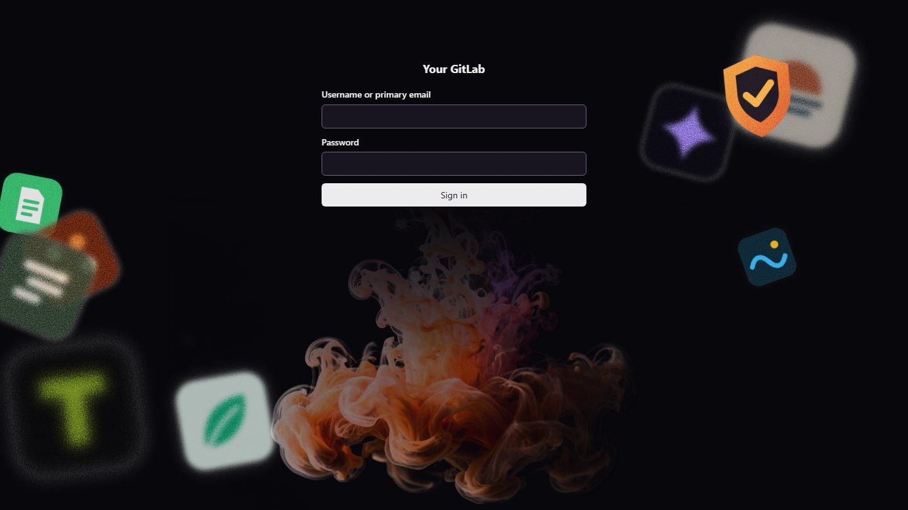
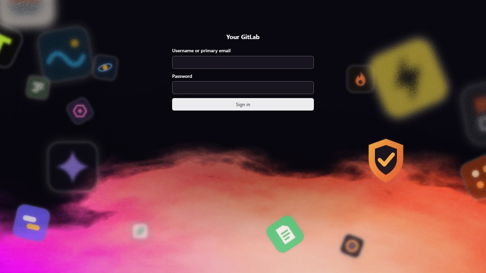

# GitLab custom login page

An animated sign-in page for self-managed GitLab: an abstract background, your project logos
floating around the form with depth-of-field blur and film grain, and a focus pull that follows
the cursor. No fork, no patched assets, no GitLab rebuild.



GitLab lets you change the logo and the text of the sign-in page, but not its background and not
anything dynamic. This project adds that with a tiny nginx container that injects **one
`<script>` tag** into `/users/sign_in` (`sub_filter`) and serves the assets.

- **Different on every load** – a random concept (8 backgrounds), a random layout (scatter, orbit,
  corners) and 15–20 random logos in a random order, size, rotation and blur.
- **Your logos, collected automatically** – project and group avatars are pulled from the GitLab
  API and refreshed on a schedule. A pinned logo (your company mark) is shown on every load.
- **Focus pull** – the focal plane glides to the depth of the logo nearest to the cursor.
- **Blurred corner art inside GitLab** – optionally replaces the picture in the top-right corner of
  the signed-in UI with a blurred, grainy variant of the same backgrounds.
- **Small blast radius** – only the sign-in page is rewritten. Remove one route and GitLab is stock again.
- Respects `prefers-reduced-motion`, works on phones, no dependencies, no external requests.

| | |
|---|---|
|  |  |
|  |  |

<sub>Screenshots of the bundled demo page with sample logos. On a real instance the logos are yours.</sub>

Try it without GitLab:

```bash
docker run --rm -p 8080:8080 ghcr.io/ar4ikov/gitlab-custom-login-page
```

then open <http://localhost:8080/-/login-skin/demo.html> (sample logos, concept switcher).

## How it works

```
browser ──> your ingress / proxy ──┬─ /users/sign_in ──> login-skin ──> GitLab   (+ one <script> tag)
                                   ├─ /-/login-skin/* ─> login-skin               (js, backgrounds, logos)
                                   ├─ /assets/blooms/* > login-skin               (optional corner art)
                                   └─ everything else ─> GitLab                   (untouched)
```

The container also proxies every other path to GitLab unchanged, so it can either receive just
those three paths ("path mode") or sit in front of GitLab entirely ("front mode").

## Install

Pick the variant that matches how your GitLab is exposed. In all of them `GITLAB_UPSTREAM` is the
address where the container can reach GitLab over HTTP.

| Setup | Files | Status |
|---|---|---|
| Kubernetes (Helm chart GitLab + any ingress controller) | [`deploy/kubernetes`](deploy/kubernetes/login-skin.yaml) | used in production by the author (ingress-nginx, GitLab 19) |
| Docker Compose, skin in front of GitLab | [`deploy/docker-compose`](deploy/docker-compose/docker-compose.yml) | image tested as a full pass-through proxy; this compose file itself is an example |
| Omnibus / Linux package with the bundled nginx | [`deploy/omnibus`](deploy/omnibus/gitlab.rb.snippet) | untested – feedback welcome |
| Any other reverse proxy (Traefik, Caddy, HAProxy, cloud LB) | route the three paths above to the container | – |

### Kubernetes

```bash
curl -LO https://raw.githubusercontent.com/Ar4ikov/gitlab-custom-login-page/main/deploy/kubernetes/login-skin.yaml
# edit the lines marked with  # <--  (host, TLS secret, ingress class, upstream service)
kubectl apply -n gitlab -f login-skin.yaml
```

Your existing GitLab Ingress is not modified: the extra Ingress adds more specific paths for the
same host. Rollback: `kubectl -n gitlab delete ingress gitlab-login-skin`.

No `configuration-snippet` annotations are needed, so this works with ingress-nginx where
snippets are disabled.

## Configuration

Everything is an environment variable.

| Variable | Default | Meaning |
|---|---|---|
| `GITLAB_UPSTREAM` | `http://127.0.0.1:8181` | **Set this.** Where GitLab answers HTTP (Workhorse, or its nginx), no trailing slash |
| `SKIN_CONCEPT` | `random` | `random` or one of `nebula`, `aurora`, `glass`, `orb`, `ink`, `voxels`, `topo`, `prism` |
| `SKIN_LAYOUTS` | `scatter,orbit,corners` | Layouts to choose from |
| `SKIN_COUNT` | `15-20` | Logos per page load (`min-max`) |
| `SKIN_GRAIN` | `0.38` | Film grain strength, `0`–`1` |
| `GITLAB_TOKEN` / `GITLAB_TOKEN_FILE` | – | Token with `read_api` scope used to list projects and download avatars |
| `LOGO_VISIBILITY` | `public` | Which projects/groups may appear: `public`, `internal`, `all`, `none` |
| `LOGO_GROUP` | – | Only this group and its subgroups (`infrastructure`, `a/b`) |
| `LOGO_REPO_FILES` | – | For projects without an avatar, try these repo files: `"logo.svg public/favicon.svg"` |
| `LOGO_MAX` | `60` | Upper bound of collected logos |
| `LOGO_REFRESH_SECONDS` | `21600` | Re-collect interval, `0` = only at start |
| `GITLAB_API_URL` | `$GITLAB_UPSTREAM/api/v4` | API base, if different from the upstream |
| `LOGO_API_HOST` | – | `Host` header for API calls when the upstream is an internal address |
| `LOGIN_SKIN_PINNED_URL` | – | Image URL of the logo that is shown on every load |
| `LOGO_DEMO` | `0` | `1` adds the bundled sample logos |

### Logos

Sources are merged in this order and de-duplicated:

1. **Your own files** – mount a directory at `/logos-custom` (png, svg, jpg, webp, gif, ico).
   A file named `pinned.*` becomes the pinned logo: always shown, always sharp, on top.
2. **GitLab API** – avatars of projects and groups, optionally logo files from repositories.

> [!WARNING]
> The sign-in page is public. Every logo you allow here is visible to anyone who can open it,
> even if the project itself is private. That is why the default is `LOGO_VISIBILITY=public`;
> switch to `internal` or `all` only if showing those logos (not names) is fine for you.

Without a token only the projects GitLab shows to anonymous users are collected. With no logos
at all you simply get the animated background.

### Corner art inside GitLab

Recent GitLab versions draw a picture in the top-right corner of the signed-in UI
(`/assets/blooms/bloom-side-<hash>.png`). If that path is routed to the container it answers with
one of six blurred variants, a new one on every page load. Don't route the path to keep the stock
picture. Older GitLab versions don't have this asset, the route is then simply unused.

## Limits and notes

- A strict `Content-Security-Policy` with nonces would block the injected script. GitLab's CSP is
  disabled by default on self-managed instances; if you enabled it, allow `'self'` scripts for
  `/-/login-skin/`.
- The sign-in path is assumed to be `/users/sign_in` (no relative URL root).
- The selector the script waits for is `body.login-page`. Verified on GitLab 19; the markup of
  that page rarely changes, but a major redesign could require an update.
- Not affiliated with or endorsed by GitLab Inc.

## Make your own backgrounds

The backgrounds were generated with Z-Image-Turbo on black and converted to transparency. The
scripts in [`tools/`](tools) reproduce them on two small GPUs (a GGUF Q4 quant split block-wise,
about 3 GB of VRAM on each):

```bash
pip install -r tools/requirements.txt
python tools/generate_backgrounds.py tools/prompts.json --out out     --base models/base --gguf models/z-image-turbo-Q4_K_M.gguf
# six frames of your choice -> skin/bloom/side-1.webp ... side-6.webp
python tools/make_blooms.py out/nebula-s11.raw.jpg out/aurora-s22.raw.jpg ... --out skin/bloom --sheet sheet.jpg
```

Both scripts have `--help`. To add a concept, drop a `.webp` into `skin/bg/` and add an entry to
`CONCEPTS` in [`skin/login-skin.js`](skin/login-skin.js).

## License

MIT, including the bundled backgrounds and sample logos.
